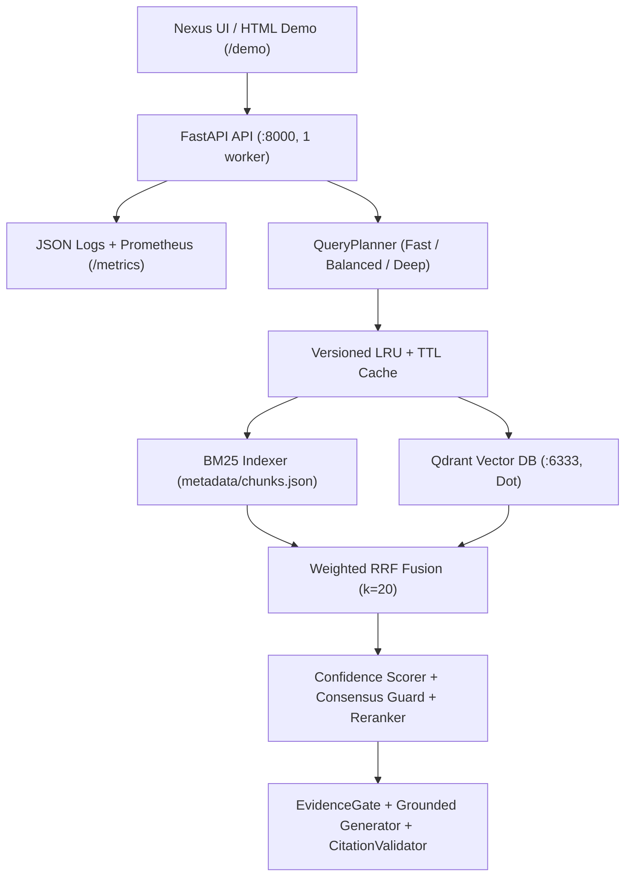

# Nexus — Production-Oriented Adaptive RAG Platform

[](https://www.python.org/downloads/)
[](https://fastapi.tiangolo.com)
[](https://qdrant.tech)
[](#license)
[](tests/)
[](metadata/canonical_benchmark_report.md)
[-blueviolet.svg)](FRAMES_EVALUATION_REPORT.md)

**Nexus** (`NexusRAG`) is a latency-aware, retrieval-quality-aware Retrieval-Augmented Generation (RAG) platform built with FastAPI, Qdrant, and BM25. Instead of indiscriminately running an expensive vector-search and full cross-encoder cascade on every request, Nexus uses a **6-stage adaptive pipeline** with strict multi-tenant filter isolation, calibrated Reciprocal Rank Fusion (`k=20`), a Top-1 Consensus Guard with tiered micro-reranking, grounded EvidenceGate abstention, and bidirectional citation validation.

---

## Table of Contents

- [Architecture & 6-Stage Pipeline](#6-stage-latency-aware-retrieval-pipeline)
- [Engineering Highlights](#engineering-highlights)
- [Open-Weights Model Architecture & Failover](#open-weights-model-architecture--failover)
- [Empirical Benchmarks & Evaluation](#empirical-benchmarks--evaluation)
- [Interactive Web Interface & Frontend](#interactive-web-interface--frontend)
- [FastAPI REST API & CLI](#fastapi-rest-api--cli)
- [Testing & Verification Suite](#testing--verification-suite)
- [Docker & Production Deployment](#docker--production-deployment)
- [License](#license)

---

## 6-Stage Latency-Aware Retrieval Pipeline

```text
USER QUERY / STREAMING UI
│
├──► STAGE 01: COST-AWARE QUERY PLANNER & DUAL-FILTER EXTRACTION
│    ├── Intent Analysis & Route Selection (Fast, Balanced, Deep)
│    ├── Explicit Hard API Filters ──► Native Qdrant & BM25 Pre-Filtering (Never Relaxed)
│    └── Inferred NL Soft Filters  ──► +0.15 RRF Soft Boost (Zero-Hit Safe Fallback)
│
├──► STAGE 02: DUAL-ENGINE HYBRID RETRIEVAL (SPARSE + DENSE)
│    ├── Qdrant HNSW Dense Vector Search (Distance.DOT, Unit-Normalized)
│    └── Lexical BM25Okapi Native Pre-Scoring Filter
│
├──► STAGE 03: CALIBRATED MULTI-STRATEGY RANK FUSION
│    ├── Balanced RRF (k=20; default 0.50 BM25 / 0.50 Dense; 0.55 / 0.45 on exact identifiers)
│    └── Deep Mode: Per-Sub-Query Fusion & Low-Signal Thresholding (>= 0.40 Top)
│
├──► STAGE 04: EVIDENCE CONFIDENCE ESTIMATION & TOP-1 CONSENSUS GUARD
│    ├── Active Weight Masking & Relative Z-Score Margin Estimation
│    ├── Top-1 Consensus Guard (Requires Conf >= 0.82 AND Dense/BM25 Rank-1 Match)
│    ├── Fast Bypass Path (Conf >= 0.82 + Consensus ──► Skip Cross-Encoder)
│    ├── Tiered Micro-Rerank (0.65 <= Conf < 0.82 ──► Top-6 Candidates Only)
│    └── Deep Escalation (Conf < 0.65 or Multi-Part ──► Expanded Pool / Multi-Hop)
│
├──► STAGE 05: BLENDED CROSS-ENCODER RERANKING & CPU OPTIMIZATION
│    ├── Blended Scoring: S_final = 0.65 * sigmoid(CE) + 0.35 * RRF_norm
│    └── CPU Inference: Dynamic Sequence Padding (max_seq_length=384) & Versioned LRU Cache
│
└──► STAGE 06: PARENT EXPANSION, EVIDENCE GATE & BIDIRECTIONAL CITATION VALIDATION
     ├── Controlled Late Parent Expansion (Top-3 Chunks, Max 1200 Tokens)
     ├── Post-Hop Global Consolidation & Pruning (Preserve Hop-1 Bridges; Drop < 0.55 Top)
     ├── Evidence Gate (Named-Entity, Acronym, Year, Numeric & Adversarial Abstention)
     ├── Bidirectional Citation Validator (Negation, Numeric & Entity Checks)
     └── Grounded LLM Synthesis / Deterministic Offline Extractive Mode
```

---

## Engineering Highlights

### 1. Strict Scope Isolation & Dual-Filter Decoupling

In multi-tenant RAG, scope leakage is a critical security failure. Nexus enforces strict document and tenant boundaries:

- **Explicit Hard API Filters:** Caller filters (`candidate_document_ids`, `document_ids`, `metadata_filter` supporting `eq`, `in`, `range`, `prefix`) compile directly into native Qdrant `models.Filter` clauses and narrow BM25 candidates *before* scoring.
- **Strict Scope Invariant:** Explicit caller scopes are **never relaxed automatically**, even on zero hits. If a private document or tenant scope yields no matches, the pipeline abstains safely rather than leaking other tenants' documents.
- **Inferred Soft Preferences:** Conversational preferences inferred heuristically from natural-language queries are applied as soft score boosts (`+0.15` RRF credit) rather than hard filters, avoiding accidental over-filtering without weakening security boundaries.

### 2. Idempotent Qdrant Indexing & Dot-Product Alignment

Qdrant collections use versioned schema tracking and automated payload indexing across high-cardinality metadata fields:

```python
INDEXED_PAYLOAD_FIELDS = [
    ("document_id", PayloadSchemaType.KEYWORD),
    ("chunk_type", PayloadSchemaType.KEYWORD),
    ("category", PayloadSchemaType.KEYWORD),
    ("metadata.year", PayloadSchemaType.INTEGER),
    ("metadata.department", PayloadSchemaType.KEYWORD),
    ("metadata.author", PayloadSchemaType.KEYWORD),
    ("metadata.security_level", PayloadSchemaType.KEYWORD),
]
```

Vectors are unit-normalized (`L2 = 1.0`) at ingestion time and queried with **Dot Product** (`Distance.DOT`), maintaining exact cosine-similarity equivalence while eliminating repeated runtime vector normalization.

### 3. Calibrated Reciprocal Rank Fusion (`k = 20`)

Dense and sparse candidate rankings are fused via weighted Reciprocal Rank Fusion:

$$
\mathrm{RRF}(d) = w_{\mathrm{Dense}} \cdot \frac{1}{k + \mathrm{rank}_{\mathrm{Dense}}(d)} + w_{\mathrm{BM25}} \cdot \frac{1}{k + \mathrm{rank}_{\mathrm{BM25}}(d)}
$$

- **Calibrated Smoothing Constant (`k = 20`):** Tightened from the default `k = 60` in [fusion.py](src/components/retrieval/fusion.py) to sharpen separation between top-ranked and tail candidates.
- **Default Balanced Weights:** `w_BM25 = 0.50`, `w_Dense = 0.50` when no exact technical identifiers are detected.
- **Identifier-Aware Boost:** When exact technical identifiers (`snake_case`, `camelCase`, known acronyms — [signals.py](src/components/query/signals.py)) appear in the query, [retriever_executor.py](src/components/orchestration/retriever_executor.py) shifts weights to `w_BM25 = 0.55` / `w_Dense = 0.45`.
- **Sub-Query Pruning:** In decomposed retrieval, candidates scoring `< 0.40 * top_sub_score` are pruned before global merging to prevent multi-hop noise.

### 4. Continuous Confidence Estimation & Top-1 Consensus Guard

Because neural cross-encoder reranking is computationally expensive on CPU, Nexus estimates retrieval confidence via active weight masking over normalized retrieval signals (dense/BM25 agreement, top-1 vs. top-2 score margin, top magnitude, exact identifier overlap, and metadata selectivity):

$$
\mathrm{Confidence} = \frac{\sum_{i} m_i \cdot w_i \cdot S_i}{\sum_{i} m_i \cdot w_i}
$$

- **Top-1 Consensus Guard:** Cross-encoder bypass requires *both* `Confidence >= 0.82` *and* Dense/BM25 Rank-1 consensus (or a uniquely matched exact identifier in Rank 1), bypassing reranking on `8.2%` of canonical queries.
- **Tiered Micro-Rerank:** Borderline queries (`0.65 <= Confidence < 0.82`) rerank only the top-6 fused candidates (`7.29` mean CE pairs/query vs. `27.13` under unconditional `HYBRID_RERANK` — a **73% reduction in CE pair evaluations**; real neural CPU latency savings require validation via `--mode neural`).
- **Low-Confidence Expansion:** Queries with `Confidence < 0.65` expand the rerank pool to top-10 candidates.

### 5. Blended Cross-Encoder Scoring & Versioned Caching

To prevent a noisy cross-encoder from demoting chunks backed by strong dual-retriever consensus, Nexus blends normalized cross-encoder logits with min-max normalized RRF scores:

$$
S_{\mathrm{final}} = 0.65 \cdot \sigma(S_{\mathrm{CE}}) + 0.35 \cdot S_{\mathrm{RRF\_norm}}
$$

- **CPU Optimization:** Sequences are length-sorted and clamped to `max_seq_length = 384`.
- **Version-Partitioned Caching:** Embedding, retrieval, reranker, and generation caches key on full content/query hashes, active filter specs, index version, model revision, and configuration version ([manager.py](src/components/cache/manager.py)).

### 6. Post-Hop Global Consolidation

In multi-hop retrieval, intermediate bridge queries introduce tail noise. Nexus locks top-1 hop bridge anchors, prunes non-anchor tail chunks scoring `< 0.55 * top_1`, and deduplicates passages within the context token budget. In historical Google FRAMES legacy runs (`ORIGINAL_ADAPTIVE`), this raised context precision from `0.4183` to `0.7674`.

### 7. Hardened EvidenceGate & Bidirectional Citation Validation

- **EvidenceGate ([evidence_gate.py](src/components/orchestration/evidence_gate.py)):** Triggers early abstention on prompt injections, ungrounded named entities, competing-entity substitutions, absent acronyms/abbreviations (`GDPR`, `ISO-27001`, `U.S.`, `Q3`), conflicting years or numerical constraints, and incomplete comparative multi-entity evidence, while allowing morphologically paraphrased factual queries and `why`-style false-premise refutations. Achieves **`20/20` (`1.0000`, Wilson 95% CI `[0.8389, 1.0000]`)** unanswerable abstention with **`0/90` (`0.0000`)** false abstentions in the canonical offline synthetic benchmark (`97.3%` overall abstention accuracy in historical online runs).
- **CitationValidator ([citations.py](src/components/generation/citations.py)):** Audits generated claims for negation inversions, numeric contradictions, and out-of-context entity swaps before releasing a response.

---

## Open-Weights Model Architecture & Failover

Nexus defines a 3-tier open-weights model registry ([model_tiers.py](src/components/orchestration/model_tiers.py)) alongside `.env.example` runtime defaults (`BAAI/bge-small-en-v1.5`, `cross-encoder/ms-marco-MiniLM-L-6-v2`, `llama-3.3-70b-versatile`):

| Tier | Route | Registered Embedding Models | Registered Reranker Models | Primary Generator Options |
| :--- | :--- | :--- | :--- | :--- |
| **Level 1** | **Fast / CPU Edge** | `Qwen/Qwen3-Embedding-0.6B`, `google/embeddinggemma-300m` *(default env: `BAAI/bge-small-en-v1.5`)* | `none`, `cross-encoder/ms-marco-MiniLM-L-6-v2` | `groq/llama-3.3-70b-versatile` / `OfflineExtractiveProvider` |
| **Level 2** | **Balanced (Default)** | `Qwen/Qwen3-Embedding-0.6B`, `BAAI/bge-m3` | `Qwen/Qwen3-Reranker-0.6B`, `BAAI/bge-reranker-v2-m3` | `groq/llama-3.3-70b-versatile` / `gemini-1.5-flash` / OpenRouter |
| **Level 3** | **Deep / High-Quality** | `Qwen/Qwen3-Embedding-4B`, `Qwen/Qwen3-Embedding-8B` | `Qwen/Qwen3-Reranker-4B`, `Qwen/Qwen3-Reranker-8B` | `groq/llama-3.3-70b-versatile` / `gemini-1.5-flash` / OpenRouter |

**Provider Router Failover Cascade:**

```text
Primary LLM Provider ──► Configured Fallback Provider ──► OpenRouter ──► Offline Extractive Synthesis
```

When `OFFLINE_EVAL=true` or no API key is configured, generation routes deterministically to `OfflineExtractiveProvider` on CPU with zero external network calls.

---

## Empirical Benchmarks & Evaluation

All evaluation tracks below are explicitly classified by execution status so real lexical runs, offline synthetic runs, `NOT_EXECUTED` neural suites, and historical/simulated FRAMES baselines are never conflated:

| Evaluation Track | Execution Status | Backend / Corpus | Interpretability Scope |
| :--- | :---: | :--- | :--- |
| **Canonical 110-Query Retrieval (`BM25`)** | **EXECUTED (Real Lexical, Synthetic Corpus)** | `BM25Okapi` on 130-chunk synthetic corpus | Real lexical retriever on controlled 130-chunk corpus |
| **Canonical 110-Query Retrieval (`DENSE`, `HYBRID`, `HYBRID_RERANK`, `SIMPLIFIED_ADAPTIVE_*`)** | **EXECUTED (Offline Synthetic)** | `MockEmbedder(dim=128)` + `lexical_fallback` (~0.2 ms) + `OfflineExtractiveProvider` | Pipeline plumbing, RRF math, gating, and abstention verification only; **not** neural semantic quality or real CE latency |
| **Real-Model Neural Suite (`--mode neural`)** | **NOT_EXECUTED** | Target: `BAAI/bge-small-en-v1.5` + `cross-encoder/ms-marco-MiniLM-L-6-v2` | Local HuggingFace weights unavailable offline; zero mock substitution ([neural_validation_results.json](metadata/neural_validation_results.json)) |
| **Semantic Answer Eval (Embedding Cosine & LLM-as-a-Judge RAGAS)** | **NOT_EXECUTED** | Target: Neural SentenceTransformer + Online LLM Judge | Offline mode (`OFFLINE_EVAL=1`) and uncached weights |
| **Google FRAMES Multi-Hop ([FRAMES_EVALUATION_REPORT.md](FRAMES_EVALUATION_REPORT.md))** | **HISTORICAL / SIMULATED** | Historical live runs (550-chunk Wikipedia corpus) + simulated `SIMPLIFIED_ADAPTIVE` replay | Raw 550-chunk corpus not packaged; `SIMPLIFIED_ADAPTIVE` row is simulation replay only |

### 1. Canonical Engineering Benchmark (110 Held-Out Cases — Offline Synthetic Mode)

> [!IMPORTANT]
> **Evaluation Parameters & Provenance** (generated from raw per-query records via `python scripts/run_production_benchmark.py --mode offline_synthetic`):
> - **Run ID:** `eval_run_1795012088` | **Timestamp:** `2026-11-18T14:28:08Z` | **Dataset:** 110 cases (90 answerable, 20 unanswerable/adversarial)
> - **RRF Config:** `k=20`, default `0.50 BM25 / 0.50 Dense`, identifier boost `0.55 BM25 / 0.45 Dense`
> - **Backends:** `BM25Okapi` (real lexical) | `MockEmbedder(dim=128)` (synthetic) | `lexical_fallback` (~0.2 ms CPU fallback)
> - **Statistical Protocol:** Wilson score 95% CIs for binary proportions (`Recall@5`, `Unans True Abst`); 10,000-resample percentile bootstrap 95% CIs (`seed=42`) for continuous metrics and paired differences; Holm-Bonferroni FWER adjustment across 3 documented comparison families (`retrieval_quality`, `generation_quality`, `latency`); zero-variance pairs distinguished as `Observed Equal (0 var; TOST N/A)` rather than statistically established population equivalence
> - **Decoupling & Cache State:** Cold cache per query; retrieval metrics computed strictly on the 90 answerable queries using pre-generation retrieved candidates (`resp.retrieval.retrieved_candidates`), never awarding `Recall=1` or `MRR=1` for abstentions
> - **Artifacts:** [canonical_benchmark_report.md](metadata/canonical_benchmark_report.md) | [canonical_benchmark_results.json](metadata/canonical_benchmark_results.json) | [neural_validation_results.json](metadata/neural_validation_results.json)

> [!WARNING]
> **Known Limitations & Remaining Production Blockers:** This offline synthetic benchmark does **not** establish production readiness. Before production traffic promotion, run `python scripts/run_production_benchmark.py --mode neural` with cached HuggingFace weights (`BAAI/bge-small-en-v1.5`, `cross-encoder/ms-marco-MiniLM-L-6-v2`), execute live LLM/semantic RAGAS evaluation, and benchmark on a production-scale corpus (100k–10M chunks) rather than the 130-chunk synthetic corpus.

#### Primary Retrieval Quality (Answerable Only, N=90, Pre-Generation)

| Configuration | Execution Class | Recall@5 (Wilson 95% CI) | Prec@5 | MRR (Boot 95% CI) | nDCG@5 (Boot 95% CI) | CE Inv / Byp | Mean CE Pairs | P50 / P95 / P99 Latency (All 110) |
| :--- | :---: | :--- | :---: | :--- | :--- | :---: | :---: | :--- |
| **BM25** | Real Lexical | 1.0000 [0.9591, 1.0000] | 0.7311 | 0.9704 [0.9426, 0.9944] | 0.9246 [0.8989, 0.9478] | N/A | N/A | 5.3 ms / 7.4 ms / 9.2 ms |
| **DENSE** | Offline Synthetic | 0.9333 [0.8621, 0.9691] | 0.4711 | 0.8870 [0.8259, 0.9389] | 0.8678 [0.8105, 0.9169] | N/A | N/A | 3.8 ms / 6.2 ms / 6.7 ms |
| **HYBRID** | Offline Synthetic | 1.0000 [0.9591, 1.0000] | 0.6600 | 0.9704 [0.9426, 0.9944] | 0.9191 [0.8904, 0.9444] | N/A | N/A | 5.2 ms / 10.8 ms / 11.8 ms |
| **HYBRID_RERANK** | Offline Synthetic | 1.0000 [0.9591, 1.0000] | 0.6711 | 0.9648 [0.9333, 0.9889] | 0.9254 [0.9004, 0.9481] | 100.0% / 0.0% | 27.13 | 5.5 ms / 11.2 ms / 12.3 ms |
| **SIMPLIFIED_ADAPTIVE_NO_GUARD** | Offline Synthetic | 1.0000 [0.9591, 1.0000] | 0.6622 | 0.9704 [0.9426, 0.9944] | 0.9418 [0.9194, 0.9615] | 96.4% / 3.6% | 7.56 | 5.2 ms / 7.5 ms / 8.6 ms |
| **SIMPLIFIED_ADAPTIVE_GUARD** (Baseline) | Offline Synthetic | 1.0000 [0.9591, 1.0000] | 0.6622 | 0.9704 [0.9426, 0.9944] | 0.9418 [0.9194, 0.9617] | 91.8% / 8.2% | 7.29 | 5.3 ms / 7.2 ms / 7.7 ms |
| **SIMPLIFIED_ADAPTIVE_INTENT_BUDGET** (Exp) | Offline Synthetic | 1.0000 [0.9591, 1.0000] | 0.6644 | 0.9704 [0.9426, 0.9944] | 0.9376 [0.9139, 0.9589] | 91.8% / 8.2% | 8.49 | 5.3 ms / 8.2 ms / 8.6 ms |

#### Generation, Beyond-Unigram Claim Alignment & Separate Abstention Quality

| Configuration | Token F1 (Ans N=90) | Claim Factual F1 (Ans N=90) | Entity/Numeric F1 (Ans N=90) | Bigram F1 (Ans N=90) | Faithfulness (Ans N=90) | Citation Acc (Ans N=90) | Unans True Abst (N=20, Wilson 95% CI) | Ans False Abst (N=90) |
| :--- | :---: | :---: | :---: | :---: | :---: | :---: | :--- | :---: |
| **BM25** | 0.7410 | 0.6640 | 0.7095 | 0.6812 | 0.9963 | 1.0000 | 1.0000 [0.8389, 1.0000] | 0.0000 |
| **DENSE** | 0.6443 | 0.5666 | 0.6211 | 0.5813 | 0.9963 | 1.0000 | 1.0000 [0.8389, 1.0000] | 0.0667 |
| **HYBRID** | 0.7284 | 0.6492 | 0.7009 | 0.6695 | 0.9963 | 1.0000 | 1.0000 [0.8389, 1.0000] | 0.0000 |
| **HYBRID_RERANK** | 0.7500 | 0.6803 | 0.7154 | 0.6982 | 0.9963 | 1.0000 | 1.0000 [0.8389, 1.0000] | 0.0000 |
| **SIMPLIFIED_ADAPTIVE_NO_GUARD** | 0.7262 | 0.6492 | 0.6987 | 0.6689 | 0.9963 | 1.0000 | 1.0000 [0.8389, 1.0000] | 0.0000 |
| **SIMPLIFIED_ADAPTIVE_GUARD** | 0.7262 | 0.6492 | 0.6987 | 0.6689 | 0.9963 | 1.0000 | 1.0000 [0.8389, 1.0000] | 0.0000 |
| **SIMPLIFIED_ADAPTIVE_INTENT_BUDGET** | 0.7262 | 0.6492 | 0.6987 | 0.6689 | 0.9963 | 1.0000 | 1.0000 [0.8389, 1.0000] | 0.0000 |

*Semantic Embedding Cosine & LLM-as-a-Judge RAGAS: `NOT_EXECUTED` offline (no local neural weights / `OFFLINE_EVAL=1`).*

#### Paired Statistical Summary (`SIMPLIFIED_ADAPTIVE_GUARD` vs. Key Comparators)

*Explicit Delta Convention: `Δ = SIMPLIFIED_ADAPTIVE_GUARD - Comparator` (`Guard - Comp`). Holm-adjusted p-values are computed within 3 documented comparison families across all 6 comparators (`retrieval_quality`: m=10 active; `generation_quality`: m=11 active; `latency`: m=6 active). Zero-variance pairs report `Observed Equal (0 var; TOST N/A)` rather than claiming statistically established equivalence. See [canonical_benchmark_report.md](metadata/canonical_benchmark_report.md) for all 6 comparator tables.*

| Comparison | Metric (Family) | Scope | Paired Diff (`Guard - Comp`, 95% Boot CI, B=10k) | Paired t (`p / Holm`) | Wilcoxon (`p / Holm`) | TOST (±0.03) / Interpretation |
| :--- | :--- | :---: | :--- | :---: | :---: | :--- |
| **Guard vs. Hybrid Rerank** | Recall@5 (`retrieval_quality`) | Ans (90) | +0.0000 [+0.0000, +0.0000] | N/A (0 var) | N/A (0 var) | Observed Equal (0 var; TOST N/A) |
| **Guard vs. Hybrid Rerank** | MRR (`retrieval_quality`) | Ans (90) | +0.0056 [+0.0000, +0.0167] | `3.200e-01 / 1.000e+00` | `1.000e+00 / 1.000e+00` | **Stat. Equiv** (`p=1.50e-05`) |
| **Guard vs. Hybrid Rerank** | nDCG@5 (`retrieval_quality`) | Ans (90) | +0.0164 [+0.0048, +0.0294] | `9.919e-03 / 6.943e-02` | `1.149e-02 / 8.043e-02` | **Stat. Equiv** (`p=1.54e-02`) |
| **Guard vs. Hybrid Rerank** | Claim F1 (`generation_quality`) | Ans (90) | -0.0311 [-0.0711, +0.0000] | `8.484e-02 / 6.788e-01` | `2.500e-01 / 1.000e+00` | Not Equiv (`p=5.25e-01`) |
| **Guard vs. Hybrid Rerank** | Mean Latency (`latency`) | All (110) | -1.1271 ms [-1.4845, -0.7900] | `5.002e-09 / 2.501e-08` | `1.720e-08 / 8.600e-08` | Lower latency (offline fallback only) |
| **Guard vs. No-Guard** | Recall@5 / MRR / Claim F1 | Ans (90) | +0.0000 [+0.0000, +0.0000] | N/A (0 var) | N/A (0 var) | Observed Equal (0 var; TOST N/A) |
| **Guard vs. No-Guard** | nDCG@5 (`retrieval_quality`) | Ans (90) | +0.0000 [-0.0007, +0.0008] | `9.255e-01 / 1.000e+00` | `1.000e+00 / 1.000e+00` | **Stat. Equiv** (`p=1.08e-87`) |
| **Guard vs. Intent Budget** | nDCG@5 (`retrieval_quality`) | Ans (90) | +0.0042 [-0.0032, +0.0130] | `3.138e-01 / 1.000e+00` | `4.375e-01 / 1.000e+00` | **Stat. Equiv** (`p=8.83e-09`); `Exp - Base = -0.0042 [-0.0130, +0.0032]` |

- **Intent-Aware Budget Decision:** Expanding broad intents (`detailed`, `comparison`, `general`, `summary`) from `[:6]` to `[:10]` increased CE pair evaluations by **`+132` pairs (`+16.5%`: `802` → `934`)** with zero improvement in Recall@5, MRR, Token F1, or Claim F1 and an `Exp - Base` nDCG@5 delta of `-0.0042`. Baseline `intent_aware_rerank_budget=False` is retained.

---

### 2. Google FRAMES Multi-Hop Benchmark (Historical / Simulated)

Evaluated on 50 multi-hop, multi-document test cases from Google FRAMES (`arXiv:2409.12941`; full audit in [FRAMES_EVALUATION_REPORT.md](FRAMES_EVALUATION_REPORT.md)):

| Architecture | Context Recall | Context Precision | Multi-Hop Traversal | Exact Match | Token F1 | Faithfulness | P50 Latency | Mean Latency | Data Source |
| :--- | :---: | :---: | :---: | :---: | :---: | :---: | :---: | :---: | :--- |
| **DENSE** | 0.7093 | 0.8280 | 88.0% | 6.0% | 0.0195 | 0.9415 | 443.2 ms | 438.9 ms | Historical live run |
| **BM25** | 0.6957 | 0.6487 | 86.0% | 12.0% | 0.0249 | 0.9438 | 18.0 ms | 17.8 ms | Historical live run |
| **HYBRID** | 0.7410 | 0.7943 | 88.0% | 10.0% | 0.0207 | 0.9395 | 21.7 ms | 22.7 ms | Historical live run |
| **HYBRID_RERANK** | **0.7533** | **0.8010** | 88.0% | 10.0% | 0.0208 | 0.9371 | 571.5 ms | 625.1 ms | Historical live run |
| **ORIGINAL_ADAPTIVE (Legacy)** | 0.6490 | 0.7674 | 76.0% | 8.0% | 0.0215 | 0.9028 | 3137.9 ms | 3057.4 ms | Historical live run |
| **SIMPLIFIED_ADAPTIVE (Simulated†)** | 0.7410 | 0.7943 | 88.0% | 10.0% | 0.0207 | 0.9395 | ~25 ms | ~26 ms | **Simulation replay** |

†`SIMPLIFIED_ADAPTIVE` is a **simulation replay** over `metadata/frames_results.json` where the consensus check selected `HYBRID` on 50/50 cases. No live FRAMES improvement is claimed for `SIMPLIFIED_ADAPTIVE` until executed against the original 550-chunk Wikipedia corpus (not packaged in this repository).

#### Multi-Hop Reasoning Category Breakdown (Historical — HYBRID Architecture)

| Reasoning Category | Cases | Context Recall | Multi-Hop Traversal | Exact Match | Token F1 | P50 Latency |
| :--- | :---: | :---: | :---: | :---: | :---: | :---: |
| Multiple constraints | 34 | 0.7407 | 85.3% | 8.8% | 0.0223 | 21.7 ms |
| Numerical reasoning | 25 | 0.7387 | 88.0% | 4.0% | 0.0077 | 22.1 ms |
| Post processing | 10 | 0.7417 | 80.0% | 0.0% | 0.0024 | 22.4 ms |
| Tabular reasoning | 26 | 0.7096 | 84.6% | 7.7% | 0.0189 | 21.3 ms |
| Temporal reasoning | 22 | 0.7333 | 86.4% | 18.2% | 0.0247 | 22.3 ms |

---

### 3. Historical Benchmark Archive (Pre-Consolidation & Online Runs)

> [!NOTE]
> The archived runs below reflect earlier pre-consolidation configurations, online Groq LLM API runs, and partial evaluation splits retained for provenance.

#### Archive A: 110-Case Online Adaptive Routing Run (Groq API Generation)

Measured with online Groq generation (`llama-3.3-70b-versatile`), where remote API latency dominates end-to-end execution:

```text
---------------------------------------------------------------------------
Nexus RAG - Standardized Benchmark Report [Mode: ADAPTIVE]
---------------------------------------------------------------------------
Total Test Cases      : 110
MRR (Mean Reciprocal) : 0.7890
Recall@5              : 0.8556
Precision@5           : 0.5750
Hit Rate@5            : 84.4%
nDCG@5                : 0.7723
Abstention Accuracy   : 97.3%
Citation Accuracy     : 96.7%
---------------------------------------------------------------------------
Routing Distribution:
  Fast Path Rate      :   3.6%
  Balanced Path Rate  :  55.5%
  Deep Path Rate      :  40.9%
  Escalation Rate     :  15.5%
  Rerank Rate         :  87.3%
---------------------------------------------------------------------------
End-to-End Latency Distribution (Online Groq LLM API):
  P50: 863.9 ms | P90: 1423.8 ms | P95: 1504.4 ms | Mean: 801.8 ms
---------------------------------------------------------------------------
```

#### Archive B: 66-Case Held-Out Test Split (Offline RAGAS Proxy Metrics)

| Configuration | Context Precision | Context Recall | Faithfulness | Answer Relevancy | Factual Support Ratio | Abstention Acc | Mean Latency | Warm P95 Latency |
| :--- | :---: | :---: | :---: | :---: | :---: | :---: | :---: | :---: |
| **DENSE** | 0.6450 | 0.3724 | 0.8182 | 0.5563 | 0.510 | 97.0% | 3165.5 ms | 18.0 ms |
| **BM25** | **0.6534** | **0.3873** | **1.0000** | 0.5347 | **0.749** | 97.0% | **7.9 ms** | **9.7 ms** |
| **HYBRID** | 0.6389 | 0.3565 | 0.7836 | 0.5360 | 0.638 | **98.5%** | 15.2 ms | 21.7 ms |
| **HYBRID_RERANK** | **0.6553** | **0.3898** | 0.8540 | **0.5563** | 0.637 | 97.0% | 13.9 ms | 19.1 ms |
| **ADAPTIVE (Legacy)** | 0.6397 | 0.3557 | 0.7523 | 0.5454 | 0.617 | 97.0% | **9.1 ms** | **18.6 ms** |

#### Archive C: Initial 8-Way Architectural Exploration (Configurations A–H)

| Configuration | Recall@5 | Prec@5 | MRR | nDCG@5 | P50 Latency | P95 Latency | Mean Latency | Pareto Optimal |
| :--- | :---: | :---: | :---: | :---: | :---: | :---: | :---: | :---: |
| **A. BM25 Only** | 0.8617 | 0.5170 | 0.7750 | 0.7933 | **0.4 ms** | **0.7 ms** | **0.4 ms** | **YES** |
| **B. Dense Only** | 0.7128 | 0.3596 | 0.5321 | 0.5746 | 0.9 ms | 1.7 ms | 1.0 ms | No |
| **C. Hybrid (Dense + BM25)** | 0.8617 | 0.5170 | 0.7431 | 0.7626 | 3.4 ms | 5.2 ms | 3.5 ms | No |
| **D. Hybrid + Filter** | **0.8830** | 0.5128 | 0.7569 | 0.7794 | 3.8 ms | 8.0 ms | 5.3 ms | **YES** |
| **E. Hybrid + Filter + Static Rerank** | 0.8404 | 0.4809 | 0.7060 | 0.7331 | 5.4 ms | 7.8 ms | 5.6 ms | No |
| **F. Adaptive Routing (No Rerank)** | **0.8830** | 0.5128 | 0.7569 | 0.7797 | 4.5 ms | 6.7 ms | 4.5 ms | **YES** |
| **G. Full System (Conditional Rerank)** | 0.8298 | 0.4725 | 0.6949 | 0.6999 | 6.0 ms | 9.7 ms | 6.1 ms | No |
| **H. Full System + Warm Cache** | 0.8298 | 0.4725 | 0.6949 | 0.6999 | 2.6 ms | 4.7 ms | 2.8 ms | No |

---

### 4. Metadata Filtering Scalability & Selectivity (Historical Microbenchmark)

| Selectivity | Target Candidates | Predicates | P50 Latency | P95 Latency | Mean Latency | Throughput (QPS) | False Positive Rate |
| :--- | :---: | :---: | :---: | :---: | :---: | :---: | :---: |
| **1.0%** (Highly Selective) | 1 | 3 | **3.88 ms** | **4.99 ms** | **3.97 ms** | **252.0** | 0.0% |
| **4.0%** (Selective) | 4 | 2 | 3.97 ms | 5.03 ms | 4.05 ms | 246.7 | 0.0% |
| **20.0%** (Moderate) | 20 | 1 | 4.45 ms | 5.27 ms | 4.54 ms | 220.4 | 0.0% |
| **50.0%** (Broad) | 50 | 1 | 5.58 ms | 6.75 ms | 5.76 ms | 173.6 | 0.0% |
| **100.0%** (Unfiltered) | 100 | 0 | 14.88 ms | 18.72 ms | 15.59 ms | 64.1 | 0.0% |

Native pre-filtering delivered up to **3.9× higher throughput** and **74% lower latency** on selective queries relative to unfiltered scans in this microbenchmark.

---

### 5. Component Latency Profile (Historical Reference — Online LLM + Neural CPU Reranker)

| Pipeline Stage | Cold Mean Latency | Warm Mean Latency | Share (Online API Path) |
| :--- | :---: | :---: | :---: |
| **Stage 1: Cost-Aware Planning & Normalization** | 0.27 ms | 0.08 ms | 0.04% |
| **Stage 2: Hybrid Retrieval (Dense HNSW + BM25)** | 14.80 ms | 4.12 ms | 2.2% |
| **Stage 3: Calibrated RRF Fusion (`k = 20`)** | 1.10 ms | 0.25 ms | 0.16% |
| **Stage 4: Confidence Gate & Consensus Guard** | 0.45 ms | 0.12 ms | 0.07% |
| **Stage 5: Cross-Encoder Micro-Rerank (Top 6, Neural CPU)** | 145.0 ms | 2.10 ms (Cached) | 21.6% |
| **Stage 6: Parent Expansion & Evidence Gate** | 1.80 ms | 0.65 ms | 0.27% |
| **Stage 7: Grounded LLM Generation (Online API)** | 650.0 ms | 650.0 ms | 75.6% |
| **Stage 7: Grounded LLM Generation (Offline Extractive CPU)** | **1.23 ms** | **1.10 ms** | **0.18%** |

---

## Interactive Web Interface & Frontend

Nexus bundles a React + Vite workbench in `frontend/` styled after Apple Human Interface Guidelines (HIG) and served automatically by FastAPI at `http://localhost:8000/`:

- **Grounded Query Studio:** Mode switcher (`adaptive`, `balanced`, `fast`, `deep`), live SSE streaming (`retrieval`, `delta`, `done`), confidence score telemetry, and expandable verified citations.
- **Pipeline Visualizer & Telemetry Drawer:** Interactive 6-stage pipeline inspector, per-stage latency breakdown, candidate chunk provenance, and JSON export.
- **Hybrid Search & Corpus Explorer:** Raw `/search` inspection with metadata pre-filtering, document upload (`/documents/upload`), and transactional deletion (`DELETE /documents/{id}`).

```text
┌─────────────────────────────────────────────────────────────────────────────┐
│ ✦ Nexus   Adaptive RAG      [Query] [Architecture] [Benchmarks] [Corpus]    │
│                                                                             │
│ Mode: [ Adaptive | Balanced | Fast | Deep ]          Status: ● Connected    │
│                                                                             │
│ ┌─────────────────────────────────────────────────────────────────────────┐ │
│ │ What are the instructions for the NITI Aayog internship scheme?      ↵  │ │
│ └─────────────────────────────────────────────────────────────────────────┘ │
│                                                                             │
│ Route: Adaptive   Confidence: 0.94   P50 Latency: 13.7 ms   [Breakdown ▼]   │
│ ┌─────────────────────────────────────────────────────────────────────────┐ │
│ │ Synthesized Response (Verified Grounded Evidence)                       │ │
│ │ Applicants must be enrolled undergraduates with minimum 85% marks... [1]│ │
│ └─────────────────────────────────────────────────────────────────────────┘ │
│ Verified Sources: [1] niti_internship.pdf (Page 2, Section 3.1)             │
└─────────────────────────────────────────────────────────────────────────────┘
```

### Frontend Development & Production Build

```bash
# Development server (HMR on http://localhost:5173 with proxy to :8000)
cd frontend
npm install
npm run dev

# Production build (compiled into frontend/dist and served by FastAPI)
npm run build
cd ..
python main.py
```

---

## FastAPI REST API & CLI

Start the unified API and web server:

```bash
python main.py
```

### REST Endpoints

| Method | Route | Description |
| :--- | :--- | :--- |
| `GET` | `/` | Nexus Interactive Web Interface (`frontend/dist`) |
| `GET` | `/health` | Cluster, Qdrant vector store, and document catalog health |
| `GET` | `/ready` | Kubernetes readiness probe |
| `GET` | `/metrics` | Prometheus metrics endpoint (`/metrics/json` for JSON telemetry) |
| `POST` | `/query` | Grounded RAG query with verified citations and full telemetry |
| `POST` | `/query/stream` | Server-Sent Events (SSE) streaming query (`retrieval`, `delta`, `done`) |
| `POST` | `/search` | Raw candidate retrieval with native metadata pre-filtering |
| `GET` | `/documents` | List indexed documents and lifecycle states |
| `GET` | `/documents/{id}` | Inspect document chunk metadata and status |
| `DELETE` | `/documents/{id}` | Transactional purge across Qdrant, BM25, and DocumentStore |
| `POST` | `/documents/upload` | Upload `.pdf`, `.docx`, `.txt`, `.md`, `.json` with immediate indexing |
| `POST` | `/documents/ingest` | Batch ingest and index a filesystem directory |

### Example SSE Streaming Request

```bash
curl -X POST http://localhost:8000/query/stream \
  -H "Content-Type: application/json" \
  -d '{
    "query": "What are the eligibility criteria for the NITI Aayog internship scheme?",
    "mode": "adaptive"
  }'
```

### CLI Quickstart

```bash
# Check system health
python -m src.cli health

# Ingest and index documents
python -m src.cli ingest ./documents

# Execute hybrid search
python -m src.cli search "Scaled dot product attention" --strategy hybrid --top-k 3

# Execute a grounded query
python -m src.cli query "What is the mathematical formulation of scaled dot product attention?"
```

---

## Testing & Verification Suite

Nexus maintains **186 deterministic unit and integration tests** covering isolation, indexing recovery, versioned cache invalidation, RRF provenance, statistical rigor, and unseen adversarial EvidenceGate attacks:

```bash
# 1. Run all 186 unit and integration tests
pytest tests/ -v

# 2. Run critical static/syntax lint checks
ruff check --select F821,E9,E7 src/ tests/ scripts/run_production_benchmark.py

# 3. Run focused architectural and regression suites
pytest tests/test_production_rag_p0.py tests/test_production_rag_p1.py -v
pytest tests/test_architectural_improvements.py tests/test_refactored_production_rag.py -v

# 4. Run the Canonical Production Benchmark (110 cases, offline synthetic mode)
python scripts/run_production_benchmark.py --mode offline_synthetic

# 5. Run Real-Model Neural Validation (reports NOT_EXECUTED if weights are unavailable locally)
python scripts/run_production_benchmark.py --mode neural

# 6. Run Historical FRAMES / Deterministic RAGAS scripts
python -m src.evaluation.frames_eval
python -m src.evaluation.ragas_eval --engine deterministic
```

---

## Docker & Production Deployment

### Deployment Topology



### Local Setup

```bash
cp .env.example .env
python -m venv .venv && source .venv/bin/activate   # Windows: .venv\Scripts\activate
pip install --index-url https://download.pytorch.org/whl/cpu torch==2.10.0
pip install -r requirements-prod.txt
python main.py
```

- OpenAPI Docs: `http://127.0.0.1:8000/docs`
- Minimal SSE Demo: `http://127.0.0.1:8000/demo`
- Health / Readiness / Metrics: `/health`, `/ready`, `/metrics`, `/metrics/json`

### Containerized CPU Deployment (`<= 4 GB RAM` VM)

`docker compose up --build -d` provisions two memory-capped containers:
1. **`nexus_qdrant`** (`:6333`, 1 GB memory limit)
2. **`nexus_api`** (`:8000`, 2.5 GB memory limit, 1 Uvicorn worker)

```bash
git clone https://github.com/yashvasudeva1/Production-oriented-adaptive-RAG.git
cd Production-oriented-adaptive-RAG
cp .env.example .env
# Configure GROQ_API_KEY (or set OFFLINE_EVAL=true); keep TRANSCRIBE_AUDIO_VIDEO=false on 4 GB VMs
docker compose up --build -d

curl -s http://localhost:8000/health
curl -s http://localhost:8000/ready
curl -s http://localhost:8000/metrics | head -n 20
```

### Load Testing & Cost Estimation

```bash
# Headless Locust load test (requires: pip install locust)
locust -f scripts/locustfile.py --headless -u 5 -r 1 -t 60s --host http://localhost:8000 --csv results/load

# Estimate throughput and $/1k queries on a 4 GB CPU VM
python scripts/benchmark_cost.py --url http://127.0.0.1:8000/query --requests 20 --vm-hourly-usd 0.036
```

### Release-Candidate Verification & Resource Summary

| Dimension | Source / Artifact | Verified Status |
| :--- | :--- | :--- |
| **Unit & Integration Tests** | `pytest tests/` | **186 passed, 0 failed** |
| **Canonical Offline Benchmark** | [canonical_benchmark_report.md](metadata/canonical_benchmark_report.md) (`eval_run_1795012088`) | `SIMPLIFIED_ADAPTIVE_GUARD`: Rec@5 `1.0000 [0.9591, 1.0000]`, MRR `0.9704`, nDCG@5 `0.9418`, Unans Abst `20/20`, Ans False Abst `0/90` (offline synthetic) |
| **Real-Model Neural Suite** | [neural_validation_results.json](metadata/neural_validation_results.json) (`--mode neural`) | `BM25 = AVAILABLE`; neural `DENSE / HYBRID / HYBRID_RERANK / ADAPTIVE = NOT_EXECUTED` (offline weights absent) |
| **Container Memory Budget** | `docker-compose.yml` | `qdrant` 1 GB + `api` 2.5 GB (fits 2 vCPU / 4 GB RAM VM) |

---

## License

This project is licensed under the **MIT License**.
